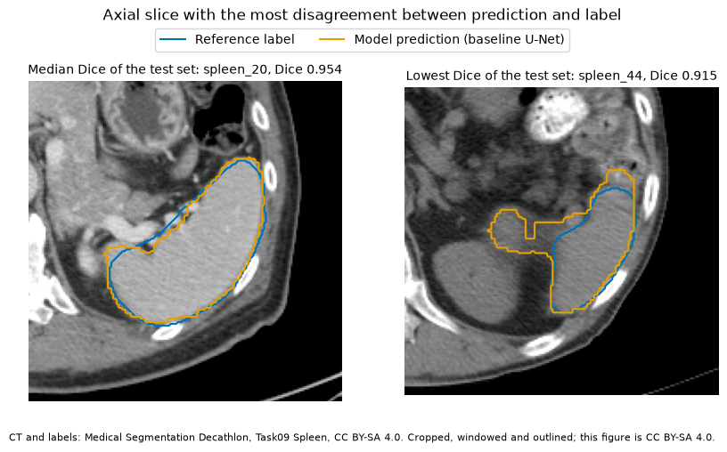

# Spleen CT Segmentation

3D segmentation of the spleen on abdominal CT scans with PyTorch and MONAI.

> **Research / portfolio project. NOT a medical device.**
> It is not validated for clinical use and must not be used for diagnosis or treatment decisions.

## Status

Both models are trained and were evaluated once on the held-out test set (Results below).
The baseline is exported to ONNX and prediction runs in a Docker image (below). This README only
reports numbers produced by real runs. What the model is for, and not for, is summarised in the
[model card](MODEL_CARD.md).



*The baseline on the test set: the case with the median Dice and the one with the lowest, picked
by code from the saved scores, each on the slice where prediction and label disagree most. On
spleen_44 the prediction leaks into neighbouring tissue. CT and labels: Medical Segmentation
Decathlon, Task09 Spleen, CC BY-SA 4.0; cropped, windowed and outlined. This figure is
CC BY-SA 4.0; the code that draws it (`spleenseg.figure`) is MIT.*

## Problem

Given a 3D CT volume of the abdomen, predict for every voxel (3D pixel) whether it belongs to the
spleen. This is binary semantic segmentation.

## Data

- **Source:** [Medical Segmentation Decathlon](http://medicaldecathlon.com/), Task09 Spleen:
  61 CT volumes from Memorial Sloan Kettering Cancer Center (41 training + 20 testing).
  Only the 41 training volumes have labels, so only these are used here.
- **Labels:** per the dataset paper, the spleen was segmented semi-automatically, then the
  contours were adjusted by an expert abdominal radiologist.
- **Split:** 27 train / 7 validation / 7 test, **by case**, with a fixed seed, committed in
  [splits/split.json](splits/split.json) before any training.
  The dataset ships no patient IDs, and its source study imaged patients before and after
  chemotherapy, so a patient-level split **cannot be guaranteed**: two cases might be the
  same person. See [decision record 0001](docs/decisions/0001-case-level-split.md).
- **License:** [CC BY-SA 4.0](https://creativecommons.org/licenses/by-sa/4.0/), as stated on the
  official site. The data is **not** included in this repository.
- **Citation:**
  - Simpson et al., *A large annotated medical image dataset for the development and evaluation
    of segmentation algorithms*, [arXiv:1902.09063](https://arxiv.org/abs/1902.09063), 2019.
  - Antonelli et al., *The Medical Segmentation Decathlon*, Nature Communications, 2022,
    [doi:10.1038/s41467-022-30695-9](https://doi.org/10.1038/s41467-022-30695-9).

## Method

- **Preprocessing** (all cases): RAS orientation, resampling to 1.5 x 1.5 x 2.0 mm, intensity
  window -40 to 180 HU rescaled to [0, 1], crop to the body. Values come from statistics of the
  training cases only, see [decision record 0002](docs/decisions/0002-preprocessing.md).
- **Training input:** 96^3 patches, centred on spleen or body tissue with equal probability,
  with small rotation, zoom and intensity augmentations; no left-right flip.
- **Baseline model:** a small 3D U-Net written from scratch (1.4 M weights), two output
  scores per voxel, prediction = the larger one (no threshold).
- **Training** (same for every model): Dice + cross-entropy loss, AdamW, mixed precision,
  8 patches per step, 5000 steps. Every 250 steps the validation Dice picks the best
  checkpoint. Budget and batch were fixed from measured speed and GPU memory, not from
  validation scores. The baseline trains in about 66 min on a laptop RTX 4060 (8 GB). See
  [decision record 0004](docs/decisions/0004-training-protocol.md).
- **Second model:** MONAI's U-Net with residual units (4.8 M weights), trained with exactly the
  same settings; about 40 min and 4 times less GPU memory than the baseline. See
  [decision record 0005](docs/decisions/0005-second-model-and-post-processing.md).
- **Prediction:** from the image only; the mask is put back on the scan's original grid by
  undoing the preprocessing, then evaluated there. Only the largest connected piece is kept, for
  both models: every training label is one piece. This assumes one spleen per scan.
- **Evaluation:** per case, at the original resolution: Dice (overlap) and HD95 (95th-percentile
  border distance in mm, MONAI's definition). Mean, standard deviation and a 95 % percentile
  bootstrap interval; models are compared with a bootstrap of their per-case differences. An
  empty prediction gives Dice 0 and an undefined HD95, counted separately. The test set is used
  once. See [decision record 0003](docs/decisions/0003-evaluation.md).

## Results

**Test set:** 7 cases never read before this evaluation, scored once for both models, with a
procedure committed and pushed beforehand
([decision record 0006](docs/decisions/0006-test-evaluation.md)). Scores are per case at the
original resolution, with only the largest connected piece kept, then averaged.

| Model | Weights | Training (5000 steps) | Mean Dice [95 % interval] | Mean HD95 [95 % interval] |
|---|---|---|---|---|
| Baseline: own 3D U-Net | 1.4 M | 66 min, 4.17 GB GPU memory | 0.950 [0.936, 0.963] | 4.0 mm [1.9, 7.2] |
| MONAI U-Net, residual units | 4.8 M | 40 min, 1.05 GB GPU memory | 0.935 [0.907, 0.954] | 5.3 mm [3.1, 7.8] |

Hardware: laptop NVIDIA RTX 4060 (8 GB), mixed precision, plugged in. Intervals: percentile
bootstrap of the mean, 10,000 resamples.

**Main comparison (pre-registered):** the per-case Dice difference, MONAI U-Net minus baseline,
is -0.015 [-0.029, -0.006]. The interval is entirely below 0: **the baseline scored higher than
the MONAI U-Net on these 7 test cases** (higher on 6 of 7). For HD95 the difference is +1.3 mm
[-0.2, +2.9]: no detectable difference. On the validation set the two models showed no
detectable difference; the test set decides.

**Post-processing:** without the largest-piece step, mean HD95 on the test set would be 19.5 mm
(baseline) and 32.1 mm (MONAI U-Net), because of small false pieces far from the spleen.

**Error analysis** (the 3 lowest-Dice test cases, the same for both models, looked at on the CT):

- spleen_44, a small spleen (119 mL) on 10 slices of 5 mm: the MONAI U-Net under-segments it
  (101 mL predicted, 24 mL missed), most clearly near one end of the spleen. The baseline gets
  the volume right but leaks into neighbouring tissue on one slice.
- spleen_41: both models extend into a loop of bowel (likely the colon) that touches the tip of
  the spleen, up to 35 mm outside it. Because it touches the spleen, the largest-piece step cannot
  remove it.
- spleen_21: border disagreements only, with a median error under 1 mm.

**How to read these numbers:** 7 test cases give wide uncertainty, and with so few cases the
percentile bootstrap interval is even too narrow. Each model was trained once, with one seed, so
part of the difference could come from training randomness. The split is case-level (see Data).

## Deployment: ONNX export

The baseline network is exported to a single 5.69 MB ONNX file that ONNX Runtime can run
without PyTorch; it was chosen because it scored higher on the test set. On the 7 validation
cases its masks differ from PyTorch's (both on the CPU) by 14 voxels out of about 590,000 spleen
voxels: near-ties decided by rounding. Dice is unchanged to 4 decimals in 6 of 7 cases.

Speed on one validation scan (median of 5 runs after warm-up, laptop i9-13900HX + RTX 4060,
plugged in):

| Backend | One 96^3 window | Whole scan |
|---|---|---|
| PyTorch, GPU | 0.016 s | 0.75 s |
| PyTorch, CPU | 0.24 s | 13.7 s |
| ONNX Runtime, CPU | 0.34 s | 36.3 s |

ONNX Runtime is slower than PyTorch on this CPU: the export is for portability, not speed.
Preprocessing and the sliding window still use MONAI and PyTorch. See
[decision record 0007](docs/decisions/0007-onnx-export.md).

## Run with Docker

A CPU image runs `spleenseg.predict` with the same locked libraries on any machine with Docker.
The image holds no data and no model weights: the scans, a model folder (`best.pt` +
`summary.json` from a training run) and an output folder are mounted when it starts.

```bash
docker build -t spleenseg .
docker run --rm \
  -v "$PWD/scans:/work/in:ro" \
  -v "$PWD/outputs/runs/<run>:/work/model:ro" \
  -v "$PWD/masks:/work/out" \
  spleenseg --run-dir /work/model --image /work/in/<scan>.nii.gz --out-dir /work/out
```

Each `-v host:container` mounts a folder of this computer into the container; `:ro` makes it
read-only. The mask is written to `masks/`, on the scan's original grid. On Linux, add
`--user "$(id -u):$(id -g)"` if the container cannot write to the output folder. In Git Bash on
Windows, start the command with `MSYS_NO_PATHCONV=1` so the container paths are not rewritten.

Measured on the laptop (Windows, Docker Desktop): 450 MB compressed (2.03 GB on disk), about
21 s for one validation scan on the CPU, and a mask identical voxel for voxel to the one
predicted without Docker. See [decision record 0008](docs/decisions/0008-docker-image.md).

Released versions are also published to the GitHub container registry, so the build step can be
replaced by `docker pull`: each release page gives the exact image name and digest. No trained
model is released (licence of models trained on CC BY-SA data, see
[decision record 0009](docs/decisions/0009-releases.md)), so a model folder must still be
mounted.

## Engineering

- **Every pull request** ([CI workflow](.github/workflows/ci.yml)): secret scan of the whole git
  history, locked install, lint, format, type check, tests, and the Docker image built and
  required to predict the same mask as the code.
- **Every version tag** (`v1.2.3`): the same checks, then the image is published and a GitHub
  Release names it by tag and digest ([decision record 0009](docs/decisions/0009-releases.md)).
- Decisions, with the options rejected, are kept in [docs/decisions](docs/decisions).

## Reproduce

```bash
uv sync                               # install the exact locked environment
uv run python -m spleenseg.download   # ~1.6 GB into data/ (git-ignored), MD5-verified
uv run python -m spleenseg.split      # rewrites splits/split.json; must equal the committed file
uv run python -m spleenseg.stats      # training-set statistics behind the preprocessing choices
uv run python -m spleenseg.preview    # outputs/preview_<case>.png, one training case
uv run python -m spleenseg.train --model baseline --power-note "plugged in"   # ~1 h on GPU
uv run python -m spleenseg.train --model monai_unet --power-note "plugged in" # ~40 min on GPU
uv run python -m spleenseg.predict --run-dir outputs/runs/<run>   # validation cases
uv run python -m spleenseg.evaluate --pred-dir outputs/predictions/<run>   # validation by default
uv run python -m spleenseg.compare --a outputs/eval/<run A>-val --b outputs/eval/<run B>-val
uv run python -m spleenseg.export --run-dir outputs/runs/<run>      # outputs/onnx/<run>.onnx
uv run python -m spleenseg.predict --onnx outputs/onnx/<run>.onnx   # same steps, ONNX Runtime
uv run python -m spleenseg.benchmark --run-dir outputs/runs/<run> --onnx outputs/onnx/<run>.onnx --power-note "plugged in"
# Test set: the exact, once-only commands are in docs/decisions/0006-test-evaluation.md
uv run python -m spleenseg.figure --pred-dir outputs/predictions/test/<run> --eval-dir outputs/eval/<run>-test
uv run pytest                         # data checks run only when data/ is present
```

## Limitations

- **Case-level split:** separating patients cannot be guaranteed (see Data above). If some
  cases are repeat scans of one person, test scores could be optimistic.
- **Small test set:** 7 cases from one hospital and one contrast phase. Nothing here shows how
  the models behave on other scanners, hospitals or patients.
- **One training run per model:** no measure of how much results vary between runs.
- **The two models differ in several ways at once** (depth, residual units, downsampling,
  activation): the comparison cannot say which difference matters.
- **One spleen per scan is assumed:** the largest-piece step would erase a real second spleen.
- **Leaks into touching organs** (such as bowel against the spleen tip) are not removed by the
  post-processing.
- **Not a medical device:** not validated for any clinical use.

## License

- Code: MIT, see [LICENSE](LICENSE).
- Data: CC BY-SA 4.0, owned by the dataset authors, not redistributed here.
- Figure [docs/figures/test-cases.png](docs/figures/test-cases.png): made from two CT slices and
  labels of the dataset, so it is shared under CC BY-SA 4.0 with the credit above.
